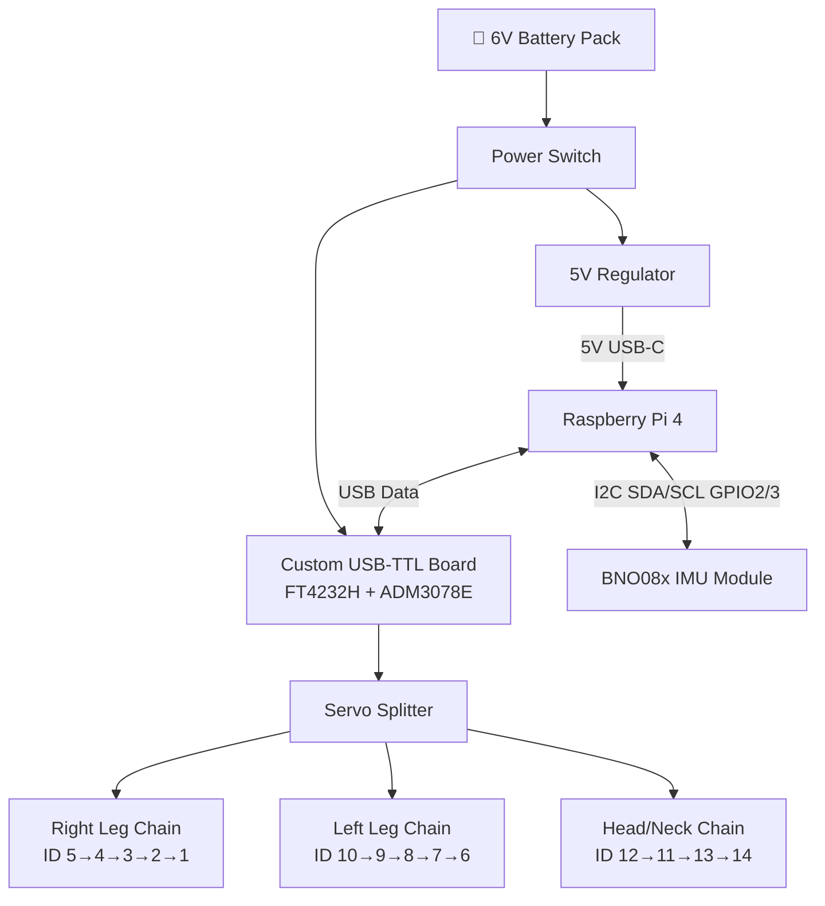
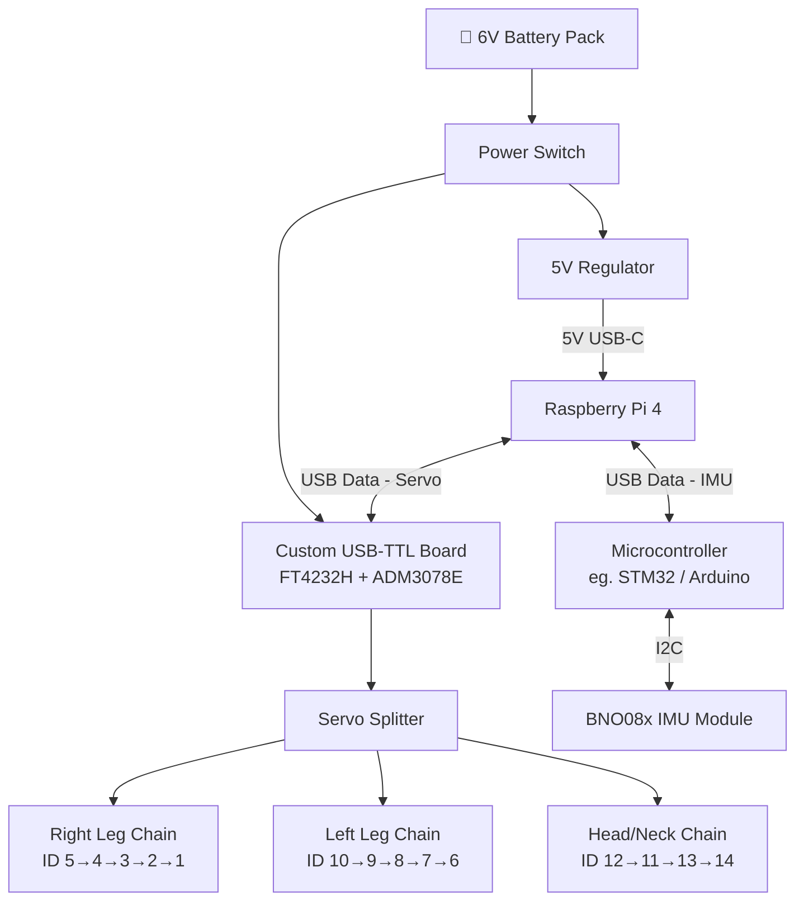

# Microduck Companion Project

A custom build of the [Microduck](https://github.com/pollen-robotics/microduck) biped robot using:
- **Raspberry Pi 4** instead of Pi Zero 2 W
- **Custom Dynamixel Interface Board** (miniaturized from [MARIN_CORE](https://github.com/RomdhoniZidane20/MARIN_CORE)) instead of OpenRB-150
- Pre-trained RL walking policy — no GPU or simulation required

---

## Bill of Materials (BOM)

| Category | Part | Qty | Notes |
| :--- | :--- | :---: | :--- |
| Main controller | Raspberry Pi 4 (2GB/4GB) | 1 | Runs walk.onnx, Wi-Fi, SSH, Bluetooth gamepad. More powerful than Pi Zero 2 W |
| Servo interface | Custom Dynamixel Interface Board (see below) | 1 | Miniaturized MARIN_CORE — replaces OpenRB-150 |
| Servos | Dynamixel XL330-M288-T | 14 | 10 for legs, 4 for head/neck |
| IMU | BNO080 / BNO085 / BNO086 module | 1 | I2C balance sensor (onboard if custom board includes it) |
| Battery | Ready-made 6V rechargeable battery pack | 1 | Powers servos |
| Power regulator | 5V regulator / USB-C power module | 1 | Powers Raspberry Pi 4 |
| Switch | Power switch | 1 | Main on/off |
| Storage | 16GB+ microSD card | 1 | OS + model storage |
| Mechanical parts | 3D-printed parts | 1 set | Print from STL files in `microduck/model/mjcf/assets/`, PLA recommended |
| Screws | M2/M2.5 self-tapping screws | Several | Servo mounting, horn, structural assembly |
| Cables | Dynamixel 3-pin cables | Several | Servo daisy chain and splitters |
| Setup tool | Dynamixel U2D2 + U2D2 Power Hub | 1 set | One-time servo ID configuration tool |

---

## Custom Dynamixel Interface Board

Based on [MARIN_CORE](https://github.com/RomdhoniZidane20/MARIN_CORE) — miniaturized to fit the Microduck form factor.

### Key Features to Retain from MARIN_CORE

| Feature | MARIN_CORE | Microduck Board (target) |
| :--- | :--- | :--- |
| RS485 buses | 4 buses | 3 buses (right leg, left leg, head/neck) |
| USB-to-serial | FT4232H | FT4232H or FT232H (single channel, smaller) |
| RS485 transceiver | ADM3078E | ADM3078E (keep, same chip) |
| IMU | BNO055 | BNO08x (matches walking model) |
| MCU co-processor | ESP32 | Optional — remove if not needed |
| Power switch | Hot swap for Intel NUC | Simplified — 6V servo power switch only |
| Form factor | Full humanoid size | Compact — fit inside Microduck chassis |

### Schematic Reference

The MARIN_CORE V4 design files (Eagle `.sch` / `.brd`) are the starting point:
- `electronics/V4/CM FT4232 with RS485 and ESP32.sch`
- `electronics/V4/CM FT4232 with RS485 and ESP32.brd`
- `electronics/V4/MARIN_CORE.zip`

### Simplification Plan (vs MARIN_CORE)

- Remove hot-swap power management (not needed for small robot)
- Remove load cell interface
- Reduce to 3 RS485 buses (from 4)
- Add 40-pin GPIO header or JST connector for Raspberry Pi 4 connection
- Reduce PCB size to fit Microduck chassis

### Interface to Raspberry Pi 4

The custom board connects to Raspberry Pi 4 via USB (FT4232H enumerates as `/dev/serial/by-id/usb-FTDI_*`). The deployment code will auto-detect it, same as OpenRB-150.

---

## Servo ID Map

Configure every servo with Dynamixel Wizard before assembly.

| ID | Name | Position |
| :---: | :--- | :--- |
| 1 | `right_ankle` | Right ankle |
| 2 | `right_knee` | Right knee |
| 3 | `right_hip_pitch` | Right hip pitch |
| 4 | `right_hip_roll` | Right hip roll |
| 5 | `right_hip_yaw` | Right hip yaw |
| 6 | `left_ankle` | Left ankle |
| 7 | `left_knee` | Left knee |
| 8 | `left_hip_pitch` | Left hip pitch |
| 9 | `left_hip_roll` | Left hip roll |
| 10 | `left_hip_yaw` | Left hip yaw |
| 11 | `head_pitch` | Head pitch |
| 12 | `neck_pitch` | Neck pitch |
| 13 | `head_yaw` | Head yaw |
| 14 | `head_roll` | Head roll |

Recommended Dynamixel Wizard settings:
- Protocol: `2.0`
- Baud Rate: `1Mbps`
- Return Delay Time: `0`
- PWM Slope: `255`
- Shutdown: remove input-voltage-error trigger to avoid shutdowns during battery dips

---

## Wiring

### Option A — IMU Direct to Raspberry Pi 4 (Simpler)



**Pros:** Simple, fewer components, direct I2C on Pi GPIO  
**Cons:** IMU wiring runs separately from servo board

---

### Option B — IMU via Microcontroller (More Flexible)



**Pros:** MCU handles IMU polling independently, cleaner separation, easier to expand sensors later  
**Cons:** Extra MCU component and USB port used

---

### Raspberry Pi 4 GPIO Pinout (Option A — Direct I2C)

```
Raspberry Pi 4 GPIO Header
┌─────────────────────────┐
│  Pin 1  → 3.3V  → IMU VIN  │
│  Pin 3  → GPIO2 → IMU SDA  │
│  Pin 5  → GPIO3 → IMU SCL  │
│  Pin 6  → GND   → IMU GND  │
│  USB-A  → Custom TTL Board  │
└─────────────────────────┘
```

### Servo Bus (3-pin daisy chain)

```
Custom USB-TTL Board
    ├── Bus 1 — Right leg chain : ID 5 → 4 → 3 → 2 → 1
    ├── Bus 2 — Left leg chain  : ID 10 → 9 → 8 → 7 → 6
    └── Bus 3 — Head/neck chain : ID 12 → 11 → 13 → 14
```

### Wiring Checklist
- Check polarity with a multimeter before powering on
- Raspberry Pi 4 and interface board must share a common ground
- Insulate all solder joints with heat-shrink tubing
- Use a data-capable USB cable (not charge-only) between Pi and TTL board

### IMU Option Comparison

| | Option A — Direct I2C | Option B — via MCU |
| :--- | :--- | :--- |
| Complexity | Low | Medium |
| Components | IMU module only | IMU + MCU board |
| Pi USB ports used | 1 (servo board) | 2 (servo + MCU) |
| Expandability | Limited | Easy to add more sensors |
| Recommended for | Quick start | Future-proof build |

---

## Build Phases

### Phase 1 — Design Custom Interface Board
- Fork MARIN_CORE V4 Eagle files as starting point
- Simplify: remove hot-swap, load cell, reduce to 3 RS485 buses
- Add Raspberry Pi 4 USB connection header
- Shrink PCB to fit Microduck chassis
- Fabricate via JLCPCB / PCBWay

### Phase 2 — 3D Print
Print all STL files from `microduck/model/mjcf/assets/`. Recommended material: PLA.

### Phase 3 — Configure Servos
Use Dynamixel Wizard + U2D2 to assign IDs 1–14 per the table above before assembling.

### Phase 4 — Assemble & Wire
Follow the wiring diagram above. Verify voltage and polarity before first power-on.

### Phase 5 — Flash SD Card
1. Download the prebuilt image: [microduck.img.xz](https://github.com/AI-FanGe/Microduck-build-tutorial/releases/download/image.v1/microduck.img.xz)
2. Flash with Raspberry Pi Imager → select `Raspberry Pi 4` → Use custom image
3. Edit `bootfs/network-config` with your 2.4GHz Wi-Fi credentials

```yaml
network:
  version: 2
  wifis:
    wlan0:
      dhcp4: true
      regulatory-domain: "YOUR_COUNTRY_CODE"
      access-points:
        "YOUR_WIFI_NAME":
          password: "YOUR_WIFI_PASSWORD"
      optional: true
```

### Phase 6 — First Run
The prebuilt image already includes `walk.onnx` — no training or GPU needed.

```bash
# SSH into the robot
ssh user@microduck.local   # default password: password

# Start the walking controller
cd ~/microduck
PYTHONPATH=src .venv/bin/python src/main.py
```

Keyboard controls:

| Key | Action |
| :--- | :--- |
| `v` | Toggle walking |
| Arrow Up / Down | Forward / Backward |
| Arrow Left / Right | Turn |
| `x` | Zero velocity |
| `i` | Show/hide IMU status |
| `q` | Stop |

---

## Raspberry Pi 4 vs Pi Zero 2 W

| Feature | Pi Zero 2 W (original) | Pi 4 (this build) |
| :--- | :--- | :--- |
| CPU | 4-core ARM Cortex-A53 1GHz | 4-core ARM Cortex-A72 1.8GHz |
| RAM | 512MB | 2GB / 4GB |
| USB | Micro USB (OTG) | USB 3.0 + USB 2.0 |
| Power | 5V via micro USB | 5V via USB-C |
| Size | Very compact | Larger — may need chassis modification |
| Performance | Sufficient for inference | More headroom for future features |

> Note: The prebuilt image targets Pi Zero 2 W. On Pi 4, flash Raspberry Pi OS Lite 64-bit manually and follow the [build tutorial](https://github.com/AI-FanGe/Microduck-build-tutorial) to set up the Python environment and copy `walk.onnx`.

---

## Updating the Walking Model

To deploy a new `walk.onnx` (e.g. retrained via `mjlab_microduck/`):

```bash
# Place new model in:
microduck/src/agents/walk.onnx

# Sync to robot:
cd microduck
make sync
```

---

## Troubleshooting

| Problem | Fix |
| :--- | :--- |
| `microduck.local` not found | Wait 1–3 min on first boot; confirm 2.4GHz Wi-Fi; check router DHCP for Pi IP |
| SSH host key changed | Run `ssh-keygen -R microduck.local` then reconnect |
| Custom board not detected | Check `lsusb` for FT4232H; verify USB cable is data-capable; check udev rules |
| Servos not moving | Check battery voltage, servo IDs, baud rate (1Mbps), board USB detection |
| Robot falls immediately | Verify left/right leg IDs not swapped, IMU orientation, correct `walk.onnx` |
| SSH drops when gamepad connects | Expected — headless mode disables Wi-Fi for Bluetooth stability; turn off gamepad to restore Wi-Fi |

---

## Safety Notes

- Always hold the robot during the first run
- Do not test near table edges
- Do not run on low battery for extended periods
- Never cut power directly — use `make shutdown` or gamepad shutdown gesture first
- Check polarity and insulation before every power-on

---

## References

- [pollen-robotics/microduck](https://github.com/pollen-robotics/microduck) — original project
- [AI-FanGe/Microduck-build-tutorial](https://github.com/AI-FanGe/Microduck-build-tutorial) — build tutorial & prebuilt image
- [microduck_rl](https://github.com/pollen-robotics/microduck_rl) — RL training repo (Isaac Lab, requires NVIDIA GPU)
- [MARIN_CORE](https://github.com/RomdhoniZidane20/MARIN_CORE) — reference design for custom Dynamixel interface board
